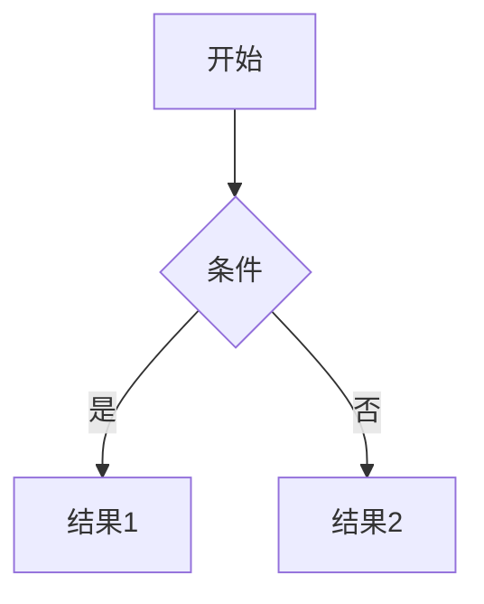

# CLAUDE.md

This file provides guidance to Claude Code (claude.ai/code) when working with code in this repository.

## 项目概述

基于 Docusaurus 3 构建的个人技术博客，专注于软件开发和人工智能领域。内容以中文为主，配置了 `zh`（默认）和 `en` 两个 locale（目前没有英文翻译）。目前约 **550+ 篇技术文档**、**35+ 篇博客**。

**技术栈:**
- Docusaurus 3.10（启用 Docusaurus Faster：Rspack + SWC + Lightning CSS）
- React 18 + TypeScript 5
- KaTeX（数学公式，样式随站点打包，不走 CDN）
- Mermaid（流程图）
- Giscus（GitHub Discussions 评论系统）
- `@easyops-cn/docusaurus-search-local`（本地搜索，中英文）
- `@docusaurus/plugin-client-redirects`（历史路径自动重定向）

**系统要求:** Node.js >= 22.13，包管理器 **pnpm**（版本见 `package.json` 的 `packageManager`）

## 项目结构

```
yiwen-blog-website/
├── blog/                    # 博客文章 (年度总结、随想、技术分享)
├── docs/                    # 技术文档，目录结构即侧边栏结构
│   ├── ai/                  # 人工智能
│   │   ├── ai_engineering/  # AI 工程化
│   │   ├── python/          # Python
│   │   └── training/        # 深度学习 (applications / architectures / deployment /
│   │                        #   frameworks / fundamentals / nlp / optimization)
│   ├── backend/             # 服务端 (architecture / devops / docker / go / java /
│   │                        #   k8s / mongodb / mysql / redis)
│   ├── cs_base/             # 计算机基础 (arithmetic / compression / cs_internet /
│   │                        #   pattern / web_pattern)
│   ├── math/                # 数学 (probability)
│   ├── native/              # 客户端 (android / flutter / harmony / ios / ReactNative)
│   ├── web/                 # Web (Antd / Css / Js / Mini / Nextjs / React /
│   │                        #   react_debugger / Rollup / taro / Umi)
│   └── whelk/               # 个人内容 (抗痘记录)
├── src/
│   ├── components/
│   │   └── Comment.tsx      # Giscus 评论组件
│   ├── css/custom.css       # 全局样式 (覆盖 Infima 变量)
│   ├── pages/index.tsx      # 首页 (重定向到 /docs/ai/)
│   └── theme/               # Swizzle (全部为 wrap 方式)
│       ├── DocItem/Paginator/   # 文档页翻页导航下方追加评论
│       └── BlogPostPaginator/   # 博客文章翻页导航下方追加评论
├── static/img/              # 图片资源
├── scripts/merge_docs.py    # 把所有文档合并成一个 md (输出 all_docs_merged.md，已 gitignore)
├── xmind/ self/             # 个人资料，不参与站点构建
├── docusaurus.config.js     # Docusaurus 配置 (异步函数模式)
├── sidebars.js              # 侧边栏配置 (全自动生成)
├── pnpm-workspace.yaml      # pnpm 配置 (依赖安装脚本白名单 allowBuilds)
└── Dockerfile               # Docker 部署配置
```

## 常用命令

```bash
# 开发
pnpm install         # 安装依赖 (prepare 脚本会同时安装 husky git hooks)
pnpm start           # 启动开发服务器 (localhost:3000，只启动默认 zh locale)

# 构建
pnpm build           # 构建生产站点 (zh + en 两个 locale)
pnpm build --locale zh   # 只构建中文，本地验证更快
pnpm serve           # 本地预览构建产物

# 代码质量
pnpm typecheck       # TypeScript 类型检查
pnpm lint:css        # CSS 检查 (Stylelint)
pnpm clear           # 清除 Docusaurus 缓存
```

## 核心配置

### docusaurus.config.js
- **配置模式:** `async function createConfig()`，因为 `remark-math` / `rehype-katex` 是纯 ESM 包，需要动态 `import()`；添加插件时保持此模式
- **站点地址:** `url: https://hao-yiwen.github.io`，`baseUrl: /yiwen-blog-website/`
- **future:** `faster: true`（构建提速），`v4.removeLegacyPostBuildHeadAttribute: true`（faster 的 ssgWorkerThreads 依赖它）
- **i18n:** `zh` (默认), `en`
- **Markdown:** MDX 格式，支持 Mermaid；`onBrokenLinks: 'throw'`，有坏链接会直接构建失败
- **数学公式:** remark-math + rehype-katex；KaTeX CSS 通过 `theme.customCss` 从 `katex` 包引入
- **侧边栏:** 全局不折叠 (`sidebarCollapsed: false`)
- **最后更新时间:** `showLastUpdateTime: true`，依赖完整 git 历史（CI 中 checkout 使用 `fetch-depth: 0`）

### sidebars.js
所有侧边栏使用 `type: 'autogenerated'`，目录结构直接决定导航：
```js
{
  aiSidebar: [{type: 'autogenerated', dirName: 'ai'}],
  backendSidebar: [{type: 'autogenerated', dirName: 'backend'}],
  nativeSidebar: [{type: 'autogenerated', dirName: 'native'}],
  webSidebar: [{type: 'autogenerated', dirName: 'web'}],
  csSidebar: [{type: 'autogenerated', dirName: 'cs_base'}],
  mathSidebar: [{type: 'autogenerated', dirName: 'math'}],
  whelkSidebar: [{type: 'autogenerated', dirName: 'whelk'}],
}
```

### 代码高亮
额外支持语言: `swift`, `java`, `bash`, `dart`, `go`, `sql`, `objectivec`, `cpp`, `ruby`, `kotlin`, `nginx`, `ini`

### 代码质量工具
- **Prettier** - 格式化 (tabWidth: 4, singleQuote: true, semi: true)
- **Stylelint** - CSS 检查 (允许单位: em, rem, s, %, px)
- **CommitLint** - Conventional commits
- **lint-staged** - 提交时只格式化 `*.{js,jsx,ts,tsx,json}` 和检查 `src/**/*.css`；**不格式化 Markdown**，避免改坏 KaTeX / MDX

## 主题定制

所有 swizzle 均采用 **wrap** 方式（只包裹原组件，不复制实现），Docusaurus 升级时无需同步上游代码。新增定制时也优先用 wrap：

```bash
pnpm swizzle @docusaurus/theme-classic <组件名> --wrap --typescript
```

- `src/theme/DocItem/Paginator` - 文档页「上一篇/下一篇」下方追加评论
- `src/theme/BlogPostPaginator` - 博客文章「上一篇/下一篇」下方追加评论
- `src/components/Comment.tsx` - Giscus 组件，`mapping="pathname"`，主题跟随站点明暗模式，语言跟随 locale

**pnpm 注意事项:** pnpm 不会把间接依赖提升到根目录，`src/` 中 import 的任何包（如 `@docusaurus/theme-common`）都必须在 `package.json` 中显式声明，版本与 `@docusaurus/core` 保持一致。

## Git 工作流

### Git Hooks (husky 9)
`pnpm install` 时由 `prepare` 脚本自动安装：
- `pre-commit`: `pnpm exec lint-staged`
- `commit-msg`: `pnpm exec commitlint --edit "$1"`

### Conventional Commits 格式
```bash
feat: 添加新功能
fix: 修复问题
docs: 更新文档
style: 代码格式 (不影响功能)
refactor: 重构代码
chore: 构建/工具更新
perf: 性能优化
test: 添加测试
```

### CI/CD
- **`.github/workflows/deploy.yml`:** push 到 master 时用 pnpm 构建并通过 `peaceiris/actions-gh-pages` 发布到 `gh-pages` 分支
- **`.github/workflows/docker-build-and-push.yml`:** 推送 `v*` 标签时构建 Docker 镜像并推送到阿里云容器镜像服务，镜像 tag 即 git 标签名

### 分支策略
- `master` - 生产分支
- `claude/*` - Claude Code 开发分支
- 功能分支使用描述性名称

## 开发指南

### 添加新文档
1. 在 `docs/` 对应目录创建 `.md` 或 `.mdx` 文件
2. 添加 frontmatter:
   ```yaml
   ---
   title: 文档标题
   sidebar_position: 1        # 可选，控制排序
   tags: [tag1, tag2]        # 可选
   ---
   ```
3. 文档会自动出现在侧边栏 (autogenerated)
4. 新建目录时添加 `_category_.json` 配置显示名（否则侧边栏直接显示目录名）：
   ```json
   { "label": "Redis", "position": 3, "link": { "type": "generated-index" } }
   ```
5. **重命名/合并文档时同步配置重定向**：若修改或合并已有文档/博客路径，需在 `docusaurus.config.js` 的 `REDIRECTS` 列表中补充旧路径到新路径的映射（Giscus 按 pathname 关联评论，尽量保持稳定命名规范：统一使用 `kebab-case`）

### 添加博客
在 `blog/` 目录创建文件:
```yaml
---
title: 文章标题
authors: [yiwen]
tags: [react, tutorial]
date: 2024-11-15
---

文章摘要...

<!-- truncate -->

正文 (摘要截断点之后)...
```
每篇博客都应加 `<!-- truncate -->`，否则博客列表页会展示全文且构建时报警告。

### 数学公式 (KaTeX)
```markdown
行内: $E = mc^2$

块级:
$$
f(x) = \int_{-\infty}^{\infty} e^{-x^2} dx
$$
```
公式中的中文必须包在 `\text{}` 里（如 `\text{期望副本数}`），否则 KaTeX 会报 `unicodeTextInMathMode` 警告。

### Mermaid 图表
````markdown

````

### MDX 组件
所有 markdown 文件都按 MDX 解析，支持 React 组件:
```jsx
import Tabs from '@theme/Tabs';
import TabItem from '@theme/TabItem';

<Tabs>
  <TabItem value="js" label="JavaScript">
    JavaScript 内容
  </TabItem>
  <TabItem value="py" label="Python">
    Python 内容
  </TabItem>
</Tabs>
```

## Docker 部署

### Dockerfile (多阶段构建)
1. **构建阶段:** `node:22-alpine`，安装 git（生成「最后更新时间」需要）和 pnpm，`pnpm install --frozen-lockfile` 后构建
2. **运行阶段:** `nginx:alpine`，复制构建产物

`.dockerignore` 不能忽略 `.git`，否则镜像内构建拿不到 git 历史。

### 构建命令
```bash
# 本地构建 (指定平台)
docker build --platform linux/amd64 -t yiwen-blog .

# 运行
docker run -p 80:80 yiwen-blog
```

## 重要提示

1. **配置模式:** `docusaurus.config.js` 使用异步函数模式 (`async function createConfig()`)，添加插件时保持此模式
2. **包管理器:** 只用 pnpm，不要提交 `package-lock.json` / `yarn.lock`；依赖需要执行安装脚本时，在 `pnpm-workspace.yaml` 的 `allowBuilds` 中声明
3. **内容语言:** 中文为主，添加新文档直接放在 `docs/` 对应目录即可自动生成导航
4. **Docker 平台:** 目标平台 `linux/amd64`
5. **提交规范:** 必须符合 Conventional Commits 规范
6. **开发验证:** 添加或修改文档时，直接写入文件即可，无需运行构建命令验证；修改框架配置、主题组件或依赖时，用 `pnpm build --locale zh` 验证
7. **评论系统:** Giscus 基于 GitHub Discussions，已集成到 Doc 和 Blog 页面

## 故障排查

```bash
# 构建失败
pnpm clear
rm -rf node_modules
pnpm install

# 类型检查失败
pnpm typecheck

# CSS 检查失败
pnpm lint:css

# 重建搜索索引
pnpm build
```

## 资源链接

- [Docusaurus 文档](https://docusaurus.io/docs)
- [KaTeX 支持符号](https://katex.org/docs/supported.html)
- [Mermaid 语法](https://mermaid.js.org/intro/)
- [Giscus 配置](https://giscus.app/)
- [Conventional Commits](https://www.conventionalcommits.org/)

## 联系方式

- GitHub: [@Hao-yiwen](https://github.com/Hao-yiwen)
- 网站: https://hao-yiwen.github.io/yiwen-blog-website/
