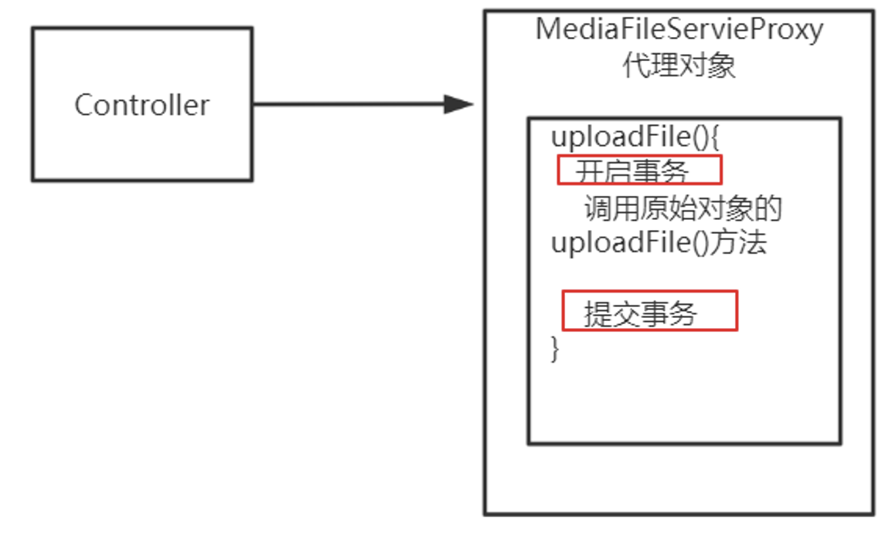

# Spring 与 Spring Cloud 常见问题（FAQ）

## 1. 为什么在 Spring Cloud 中使用 `bootstrap.yml` 而不是 `application.yml`？

`bootstrap.yml` 在应用引导阶段（**Bootstrap Phase**）由父级 `ApplicationContext` 优先加载，早于常规的 `application.yml`：

- **拉取远程配置中心**：用于声明连接 Nacos Config / Spring Cloud Config Server 的地址、命名空间与凭据，以便在业务 Bean 初始化前拿到远端配置。
- **服务注册与发现早期初始化**：配置需要在主上下文启动前就绪的基础设施元数据。

如果只是单体 Spring Boot 应用且不接入远程配置中心，直接使用 `application.yml` 即可（注：Spring Boot 2.4+ / Spring Cloud 2020+ 默认推荐使用 `spring.config.import` 替代旧版 bootstrap 上下文，也可引入 `spring-cloud-starter-bootstrap` 保持兼容）。

## 2. 本地 Swagger UI 默认访问地址示例

```text
http://localhost:63050/media/swagger-ui.html
```

## 3. `@Transactional` 自调用为什么会失效？

`@Transactional` 底层依赖 **Spring AOP 动态代理**拦截方法调用开启与提交事务。如果在同一个类的普通方法（或另一个方法）内部通过 `this.xxx()` 直接调用本类的事务方法，调用未经过 Spring 代理对象，切面拦截不会触发，事务随之失效。



> **解决方式**：将事务方法拆分到独立的 Service Bean 中注入调用，或通过 `AopContext.currentProxy()` / 自注入代理 Bean 调用。

## 4. 解决上传大文件报错 `MaxUploadSizeExceededException`

在 `application.yml` 中调大 Multipart 单文件与单次请求总大小限制：

```yaml title="application.yml"
spring:
    servlet:
        multipart:
            max-file-size: 100MB
            max-request-size: 100MB
```

## 5. Spring 声明式事务失效的 7 种典型场景汇总

1. **异常被内部 `try-catch` 吞掉**，未向代理层抛出。
2. **同类内部自调用**（非事务方法或同类方法直接通过 `this` 调用事务方法，绕过了 AOP 代理）。
3. **方法访问权限非 `public`**（Spring AOP 默认无法代理 `private` / `final` / `static` 方法）。
4. **抛出的受检异常与 `rollbackFor` 不匹配**（默认仅对 `RuntimeException` 与 `Error` 回滚，建议显式声明 `@Transactional(rollbackFor = Exception.class)`）。
5. **底层存储引擎不支持事务**（例如 MySQL 使用了 `MyISAM` 而非 `InnoDB`）。
6. **事务传播行为（`Propagation`）配置不当**（如误设为 `NOT_SUPPORTED` 或 `NEVER`）。
7. **目标类未被 Spring 容器托管**（遗漏 `@Service` / `@Component` 注解）。
