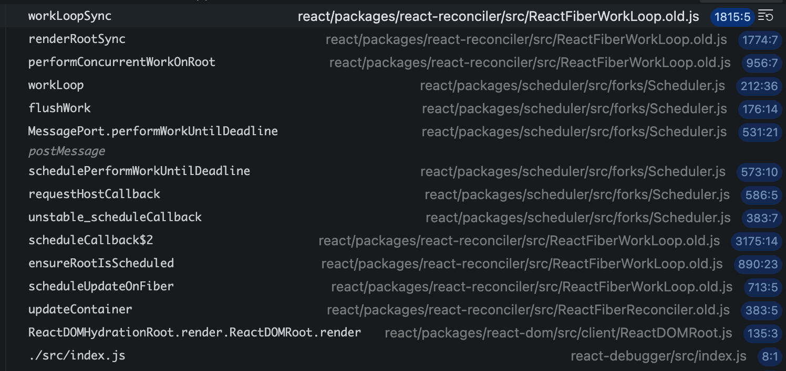

# React Scheduler 优先级调度器解析

`Scheduler` 是独立于 `Reconciler`（协调器）之外的低耦合任务调度包，专门负责基于浏览器空闲帧的时间切片（Time Slicing）与多优先级任务队列管理。

从下方调用栈可以清晰看到：`Reconciler` 在 `ensureRootIsScheduled` 阶段根据更新车道（Lane）决定调度策略——对于非同步阻塞的并发更新（Concurrent Mode），会委托 `Scheduler` 的 `unstable_scheduleCallback` 注册异步宏任务切片，按帧预算循环推进工作单元并在必要时让出主线程。

